---
# Pi Agent 实验作业
## 任务1：Pi Agent安装
安装成功截图：
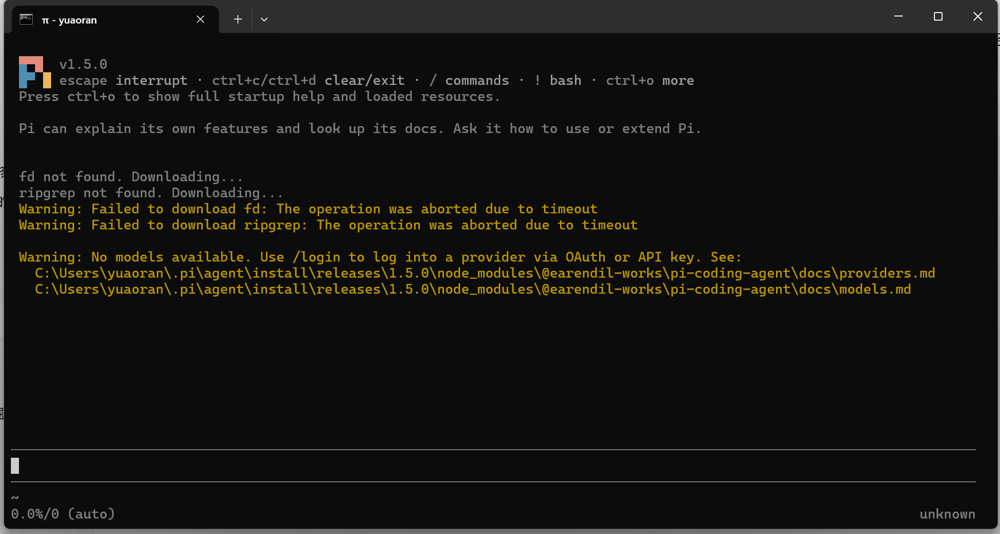

## 任务2：模型API配置
API配置截图：
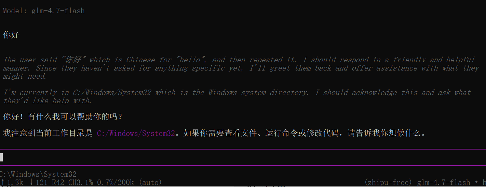

## 任务3：切换模型、思考开关对比
切换模型前：
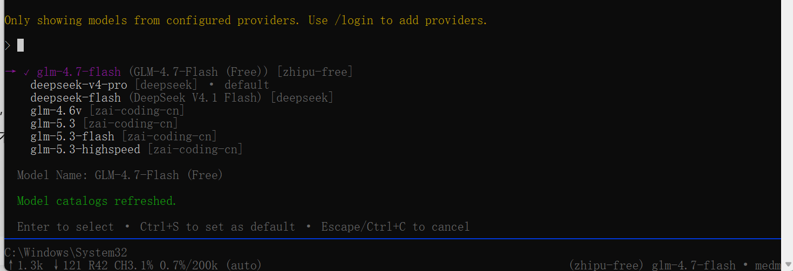
切换模型后：
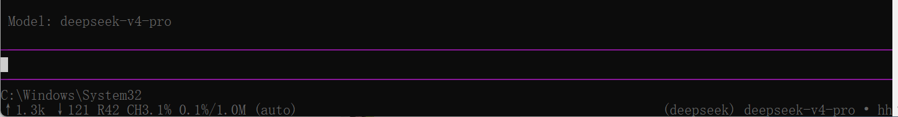
切换模型等级前：
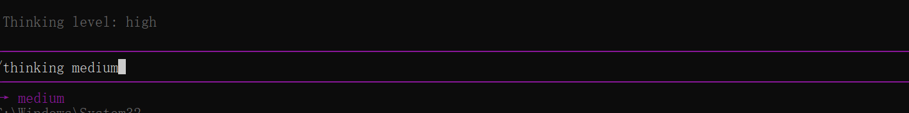
切换模型等级后：
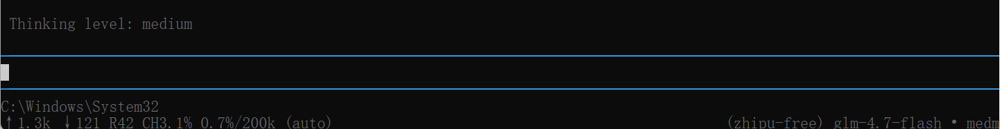

## 任务4：使用@引用代码文件
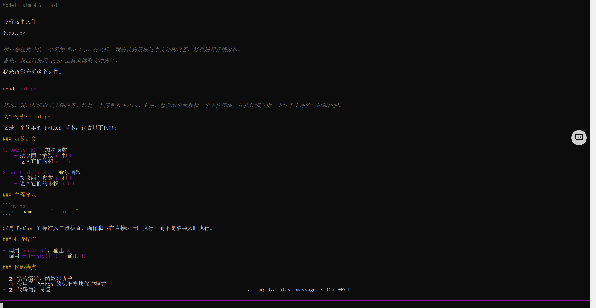
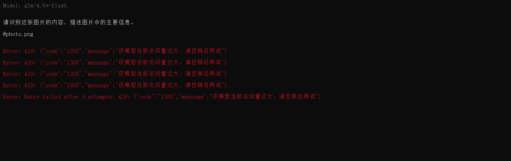

## 任务5：插件使用
下载并加载插件：
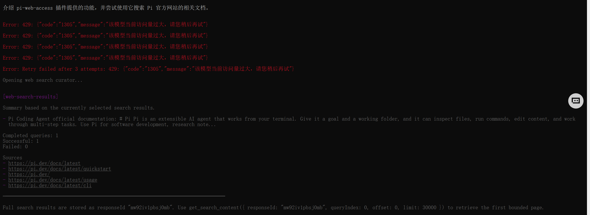
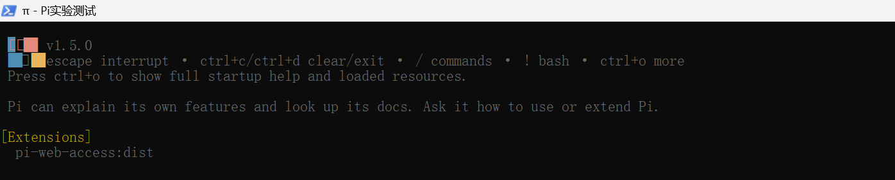

## 任务6：ppt-skill插件测试
安装ppt-skill：
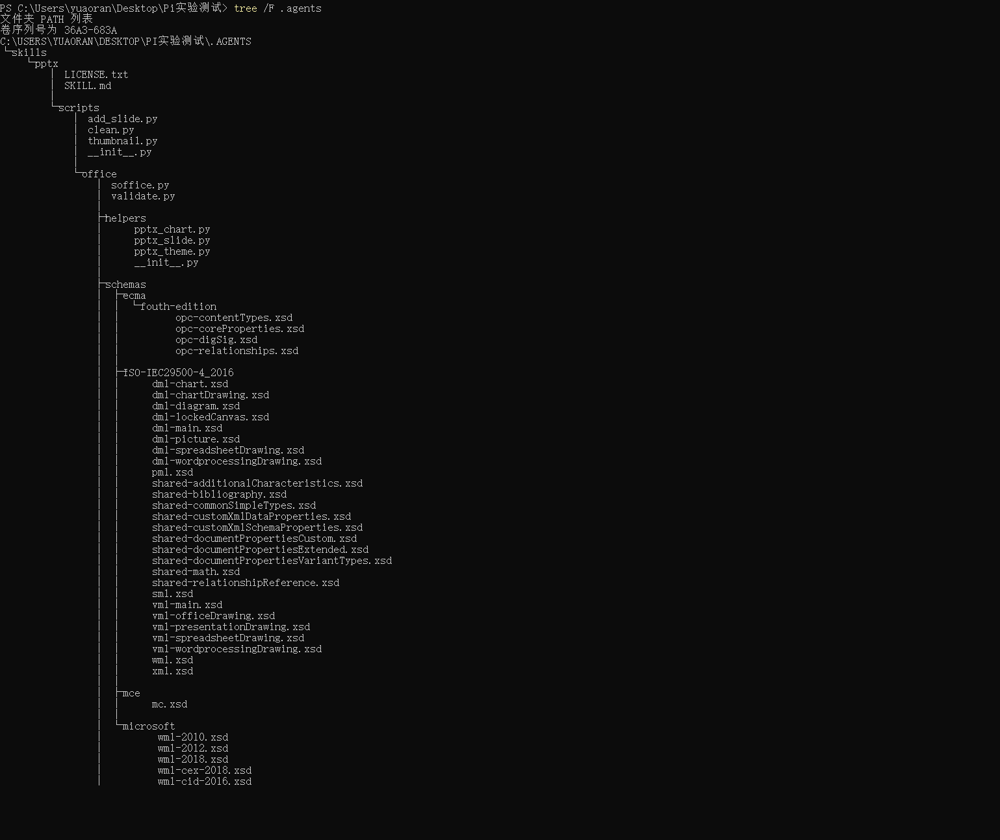
调用ppt-skill（模型无额度）：
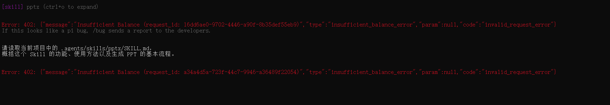
启动发现：
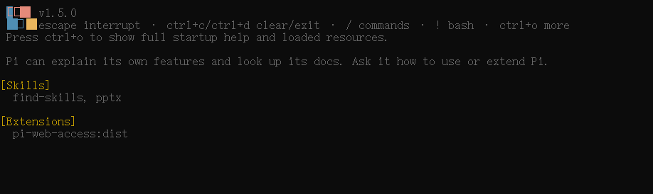
