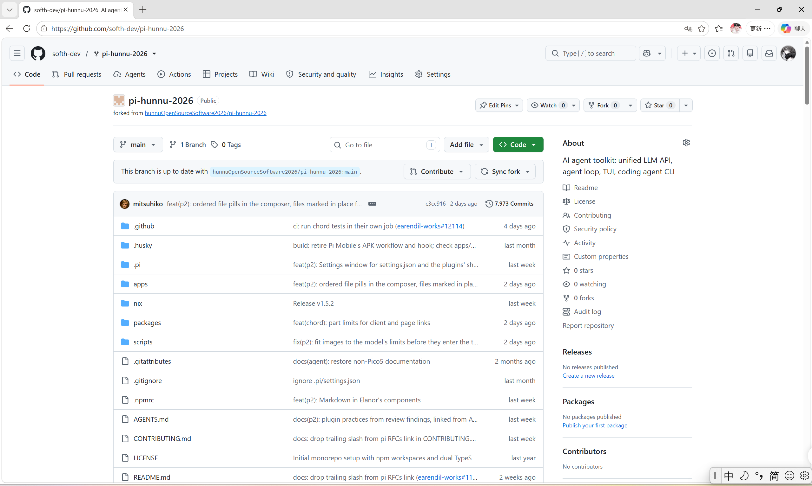
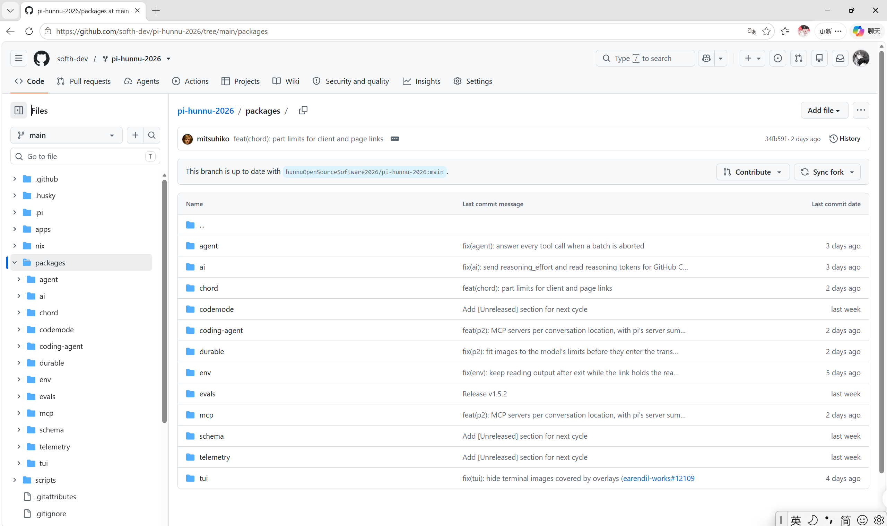
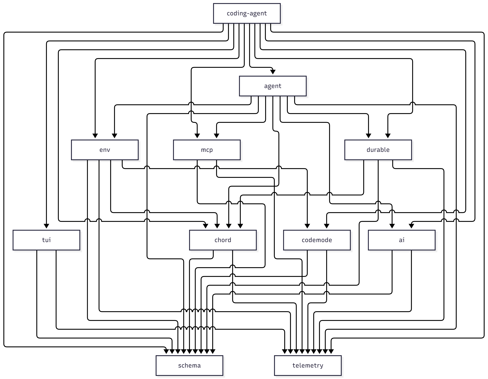

# 实践2 组织建仓与源码分析

本次分析覆盖全部模块


## 一、源码获取

### 1.组织仓库截图



### 2.Clone 后仓库信息截图


本次 Clone 地址：

https://github.com/softh-dev/pi-hunnu-2026.git

### 3.源码目录截图



## 二、模块分析

### 1.构建顺序

schema → telemetry → chord → tui → codemode → mcp → ai → durable → env → agent → coding-agent

原因：被依赖的模块应该优先完成构建。

### 2.模块分析表

| 子文件夹 | 代码主要实现什么功能 | 本模块 build 执行什么、生成什么 | 直接依赖哪些内部模块 | 依据文件或代码位置 |
|---|---|---|---|---|
| telemetry | 遥测、日志、指标采集，上报运行时统计信息 | 读取本模块 package.json、tsconfig，执行 tsc 编译 TS，输出 CommonJS/ESM 产物、类型声明 | schema | `telemetry/package.json`、`telemetry/src` |
| schema | 全局类型定义、数据模型、JSON Schema 校验，统一全项目数据结构 | tsc 编译类型代码，输出 d.ts 类型文件与 JS，无业务运行逻辑 | 无 | `schema/package.json`、`schema/src/*.ts` |
| chord | 跨进程通信、任务调度、会话事件总线，模块间消息传递核心 | tsc 编译，输出运行时通信库、事件工具 | schema、telemetry | `chord/package.json` |
| tui | 终端交互界面，CLI 交互渲染、输入处理、流式输出展示 | tsc 编译，输出终端 UI 组件库 | schema、telemetry | `tui/package.json` |
| codemode | 沙箱 JS/TS 代码执行，安全隔离脚本执行环境、工具调用封装 | tsc 编译，输出沙箱执行引擎、VM 封装 | schema、telemetry | `codemode/package.json` |
| mcp | MCP 协议客户端，对接 MCP 服务、工具协议转发 | tsc 编译，输出 MCP 协议解析、transport 实现 | schema、telemetry | `mcp/package.json` |
| ai | 大模型统一抽象层，封装多家 LLM 接口、流式请求、消息转换 | tsc 编译，输出 LLM 调用 SDK、模型适配层 | schema、telemetry | `ai/package.json` |
| durable | 持久会话层，会话持久化、状态存储、断点恢复 | tsc 编译，输出会话读写、状态持久化逻辑 | schema、telemetry、chord | `durable/package.json` |
| env | 本地执行环境，文件读写、bash 命令、沙箱环境管理 | tsc 编译，输出本地工具执行、环境隔离能力 | schema、telemetry、chord、codemode | `env/package.json` |
| agent | 智能体核心循环，规划、工具调用、会话流转、任务编排 | tsc 编译，输出 agent 主循环、状态机、prompt 管理 | schema、telemetry、chord、ai、durable、env、mcp | `agent/package.json` |
| coding-agent | CLI 入口主程序，pi 命令行，接收用户输入，拉起 agent、驱动整个应用 | tsc 编译，打包 CLI 入口，生成可执行脚本 | schema、telemetry、chord、tui、agent、ai、mcp、env、codemode、durable | `coding-agent/package.json` |

### 2.3 依赖关系图及图源

模块层级与依赖关系图：



 Mermaid 代码(完整图源)：

```text
%%{init: { "flowchart": { "curve": "linear" } } }%%
flowchart TD
    schema[schema]
    telemetry[telemetry]

    chord[chord]
    tui[tui]
    codemode[codemode]
    mcp[mcp]
    ai[ai]
    durable[durable]
    env[env]
    agent[agent]
    coding-agent[coding-agent]

    chord --> schema
    chord --> telemetry

    tui --> schema
    tui --> telemetry

    codemode --> schema
    codemode --> telemetry

    mcp --> schema
    mcp --> telemetry

    ai --> schema
    ai --> telemetry

    durable --> schema
    durable --> telemetry
    durable --> chord

    env --> schema
    env --> telemetry
    env --> chord
    env --> codemode

    agent --> schema
    agent --> telemetry
    agent --> chord
    agent --> ai
    agent --> durable
    agent --> env
    agent --> mcp

    coding-agent --> schema
    coding-agent --> telemetry
    coding-agent --> chord
    coding-agent --> tui
    coding-agent --> agent
    coding-agent --> ai
    coding-agent --> mcp
    coding-agent --> env
    coding-agent --> codemode
    coding-agent --> durable
```


## 三、问题回答

### 1.根目录与子模块中的 npm run build 分别读取什么配置、执行什么工作？

**根目录：**

主要读取根目录package.json中的scripts配置，根据里面编写的脚本安排各个模块的构建顺序。

**子模块：**

读取当前模块自己的package.json和tsconfig.json等配置，根据具体的构建命令编译本模块的代码。


### 2.构建顺序和模块依赖有什么关系？相邻构建的模块是否一定互相依赖？

构建顺序主要是由各个模块之间的依赖关系决定的。如果一个模块需要使用另一个模块提供的功能，那么通常需要先构建被依赖的模块，再构建使用它的模块。

但构建顺序相邻的两个模块不一定相互依赖。


### 3.选择一条涉及至少三个模块的依赖路径，说明这些模块如何分工。

我选择coding-agent → agent → ai → schema

coding-agent： 主要负责整个程序的入口部分，用户可以通过命令行输入指令，由它启动程序并调用其他模块。

agent： 主要负责智能体工作，例如分析用户的任务、安排执行步骤、管理会话以及调用其他工具。

ai： 主要负责与大语言模型进行交互，将任务请求发送给模型，并处理模型返回的结果。

schema： 主要负责定义项目中需要使用的数据类型和数据结构，让不同模块在传递和处理数据时有统一的规范。

