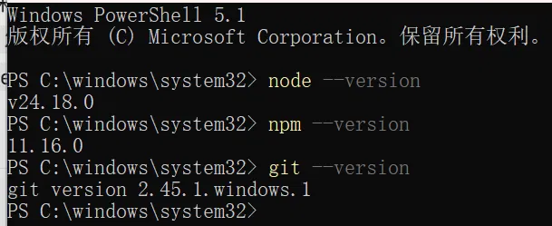
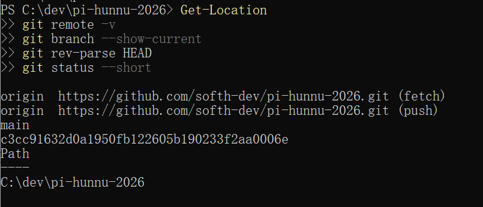
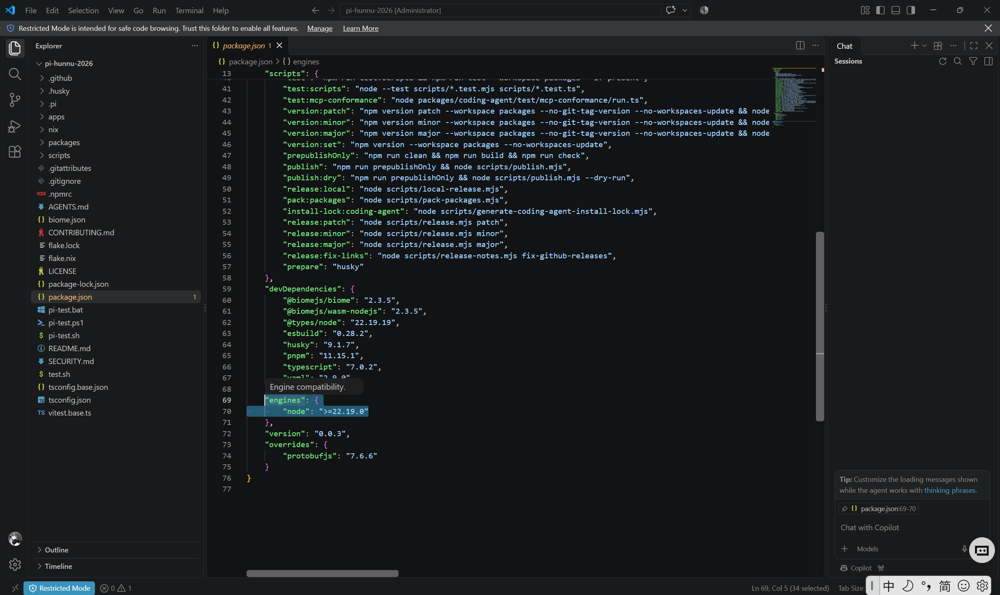
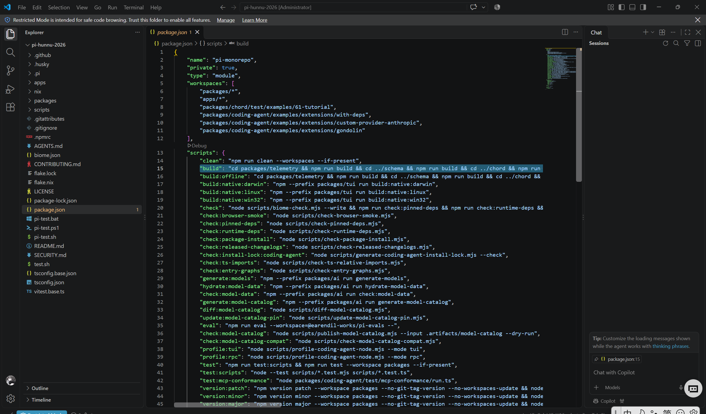
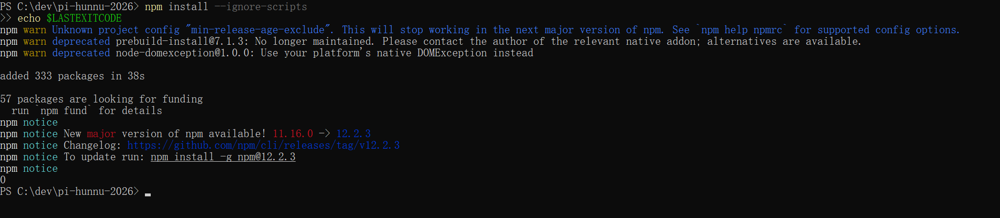
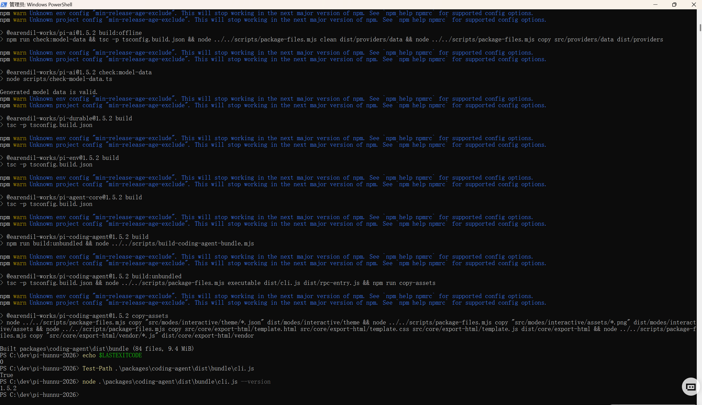
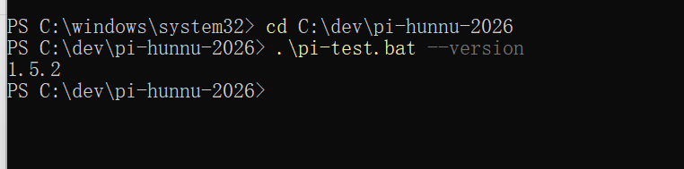
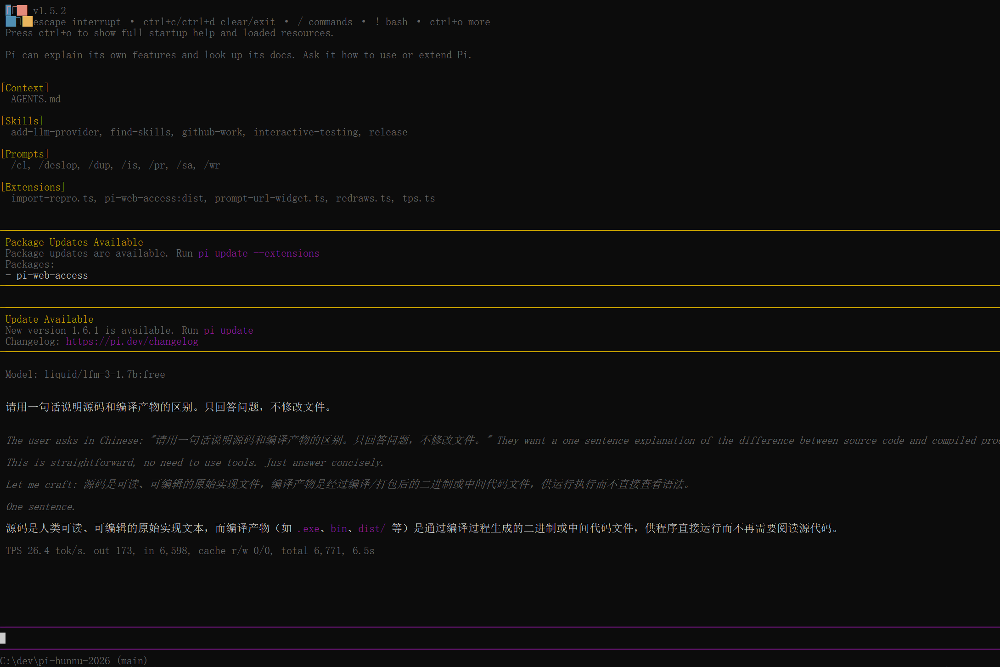
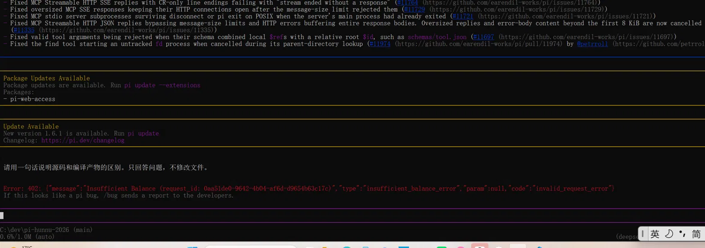

# 实践课3：Pi Agent 源码安装与编译

- 姓名：于傲然
- 学号：202430224018
- GitHub：pupycyper
- 小组仓库地址：https://github.com/softh-dev/pi-hunnu-2026

## 一、检查和安装开发工具（S1）

首先打开 PowerShell，检查电脑上已经安装的开发工具，依次执行：

```powershell
node --version
npm --version
git --version
```

检查结果如下：

| 工具 | 实际版本 |
|---|---|
| Node.js | v24.18.0 |
| npm | 11.16.0 |
| Git | 2.45.1.windows.1 |




## 二、下载项目源码（S2）

我先创建了一个 `C:\dev` 文件夹，将项目克隆到这个目录下。

执行的命令：

```powershell
mkdir C:\dev
cd C:\dev
git clone --branch main https://github.com/softh-dev/pi-hunnu-2026.git
cd pi-hunnu-2026
```

克隆完成后，检查了当前目录、远程仓库、分支和提交记录。

| 检查项目 | 实际结果 |
|---|---|
| 本地目录 | `C:\dev\pi-hunnu-2026` |
| origin | `https://github.com/softh-dev/pi-hunnu-2026.git` |
| 当前分支 | `main` |
| 提交编号 | `c3cc91632d0a1950fb122605b190233f2aa0006e` |
| 工作区状态 | 干净，没有未提交的修改 |



这个仓库是小组同学已经 fork 到组织下的仓库，所以直接克隆小组仓库即可，不需要再自己 fork 一次。

## 三、阅读项目配置（S3）

使用 VS Code 打开项目根目录，查看根目录下的 `package.json`，主要检查了 Node.js 版本要求和构建命令。

Node.js 版本要求在 `engines` 字段中：



构建命令在 `scripts` 字段中的 `build` 项：



这里主要确认了两个问题：

**1. Node.js 版本要求在哪里？**

在根目录 `package.json` 的 `engines.node` 字段中，要求为 `>=22.19.0`。

**2. `npm run build` 从哪里读取构建命令？**

它读取的是根目录 `package.json` 中的 `scripts.build`。这条命令通过 `&&` 连接了多个子包的构建操作，依次进入不同的 `packages` 目录，再执行各自的 `npm run build`。

中间某一步执行失败，后面的命令就不会继续执行。因此，根目录的构建脚本实际上是按照项目预先设置的顺序，依次完成各个子包的编译。

另外，根目录的 `package.json` 中还配置了 `workspaces`，包含 `packages/*`、`apps/*` 等目录。这说明项目采用了 npm workspaces 的多包结构，依赖统一在根目录安装，不需要进入每个子包单独安装。

## 四、安装项目依赖（S4）

确认项目配置后，在仓库根目录执行：

```powershell
npm install --ignore-scripts
echo $LASTEXITCODE
```



安装结果显示：

- 新增 333 个依赖包。
- 安装耗时约 38 秒。
- 命令退出码为 `0`。

说明依赖安装正常完成。

这一步主要是根据 `package.json` 和 `package-lock.json` 下载项目所需的依赖，并在根目录生成 `node_modules`，同时处理 workspaces 中各个本地子包之间的关联。

命令中的 `--ignore-scripts` 表示跳过安装时自动执行的脚本，例如 `postinstall`、`prepare` 等，不影响之后手动执行构建命令。

本次安装输出中没有看到漏洞统计结果，所以不对依赖的漏洞情况作额外判断。

## 五、本地编译及结果验证（S5）

依赖安装完成后，在项目根目录执行构建命令：

```powershell
npm run build
echo $LASTEXITCODE
Test-Path .\packages\coding-agent\dist\bundle\cli.js
node .\packages\coding-agent\dist\bundle\cli.js --version
```



构建完成后，终端显示：

```text
Built packages\coding-agent\dist\bundle (84 files, 9.4 MiB)
```

退出码为 `0`，`Test-Path` 返回 `True`，最后运行生成的 `cli.js`，显示版本号为 `1.5.2`。

从结果来看，项目已经成功编译，而且生成的入口文件可以正常运行。

构建过程中可以看到，根目录脚本按照顺序调用各个子包的构建命令。例如，`pi-ai` 会先检查模型数据，再进行 TypeScript 编译；其他子包也会根据各自的配置执行编译。最后进入 `pi-coding-agent`，完成未打包构建和最终的 bundle 打包。

第一次构建时，`pi-ai` 还需要联网获取模型目录数据。这里下载的是模型信息和相关配置，并不是直接下载模型本身。

另外，构建生成的文件主要放在 `packages/coding-agent/dist` 目录下。如果后续需要修改程序，应该修改 `src` 中的源码，再重新构建，而不是直接修改 `dist` 中的文件。

第一次构建成功后，如果模型目录数据已经准备好，后续可以使用：

```powershell
npm run build:offline
```

这样可以在不重新获取模型目录的情况下进行构建。

## 六、启动本地源码版本（S6）

编译完成后，接下来启动项目，验证本地源码是否能够正常运行。

首先执行：

```powershell
.\pi-test.bat --version
```



终端输出版本号 `1.5.2`，与前面编译生成的 `cli.js` 版本一致。

随后执行：

```powershell
.\pi-test.bat
```

启动 Pi 的交互界面，并输入以下问题：

```text
请用一句话说明源码和编译产物的区别。只回答问题，不修改文件。
```



Pi 成功返回了回答，界面顶部显示版本号 `1.5.2`，底部显示当前工作目录为 `C:\dev\pi-hunnu-2026 (main)`。

这说明程序已经成功启动，而且当前使用的是克隆仓库中的项目。

这里需要注意，`pi-test.bat` 虽然名字中有 test，但它并不是用来执行测试的，而是启动本地源码的入口，会调用 Node.js 运行 `packages/coding-agent/src/cli.ts`。

为了避免误用之前安装的全局版本，这次没有直接输入 `pi` 启动，而是使用项目提供的 `pi-test.bat`。

两个入口的用途也有所不同：

- **源码入口**：直接运行 `src` 中的代码，适合开发和调试，修改源码后可以直接运行查看效果。
- **编译产物入口**：运行 `dist/bundle/cli.js`，适合检查编译结果是否正常，也更接近最终发布的版本。

本次分别检查了源码入口、编译产物入口和交互界面，显示的版本号都是 `1.5.2`。

## 七、实验过程中遇到的问题及解决方法

**1. 启动 Pi 后出现 402 余额不足**

第一次启动 `.\pi-test.bat` 并发送问题后，界面出现了以下报错：

```text
Error: 402 ... Insufficient Balance
```



当时 Pi 的交互界面已经正常启动，问题是在发送请求后才出现的。因此可以判断，本地程序本身已经运行起来，报错发生在模型调用阶段。

查看模型信息后发现，当时使用的是 DeepSeek 模型，问题与模型服务账户余额有关，并不是项目编译失败。

由于不想充值，我改用了 OpenRouter 提供的免费模型。注册账户并创建 API Key 后，通过 PowerShell 环境变量设置密钥：

```powershell
$env:OPENROUTER_API_KEY="自己的API Key"
```

这样密钥只在当前 PowerShell 窗口中生效，不需要写入项目文件。之后重新启动 Pi，通过 `/model` 选择名称带有 `:free` 的模型，再发送相同的问题，就可以正常收到回复了。

设置密钥后，我先清空终端再进行截图，避免密钥出现在截图中。实验结束后，也删除了创建的 API Key。

**2. npm 安装和构建过程中出现大量警告**

安装依赖和执行构建时，终端多次出现黄色的 `warn` 信息，尤其是：

```text
Unknown project config "min-release-age-exclude"
```

一开始不太确定这些提示是否会影响构建。后来结合退出码和实际生成的文件进行检查，发现安装和构建的退出码都是 `0`，也没有出现导致任务中断的 `npm error`。

因此没有因为这些警告去修改 `.npmrc` 或强制升级依赖，最终安装和构建都正常完成。


## 八、实验小结

这次实践主要完成了 Pi Agent 项目的源码下载、依赖安装、本地编译和启动验证。

过程中用到的命令基本都是在项目根目录下执行的。通过查看 `package.json`，了解了项目对 Node.js 版本的要求，以及根目录构建脚本与各个子包之间的关系。之后完成了依赖安装，并成功生成了 `packages/coding-agent/dist/bundle` 下的编译产物。

最后分别通过源码入口和编译产物入口运行程序，两者显示的版本号都是 `1.5.2`，源码版本也成功完成了一次交互。

这次实验中比较容易混淆的是程序启动和模型调用这两个环节。之前出现的 402 报错并不是本地项目没有安装好，而是模型服务账户的问题。换用免费模型后，程序就可以正常完成交互了。通过这次操作，也对项目从源码到编译产物，再到实际运行的整个过程有了更直观的了解。
