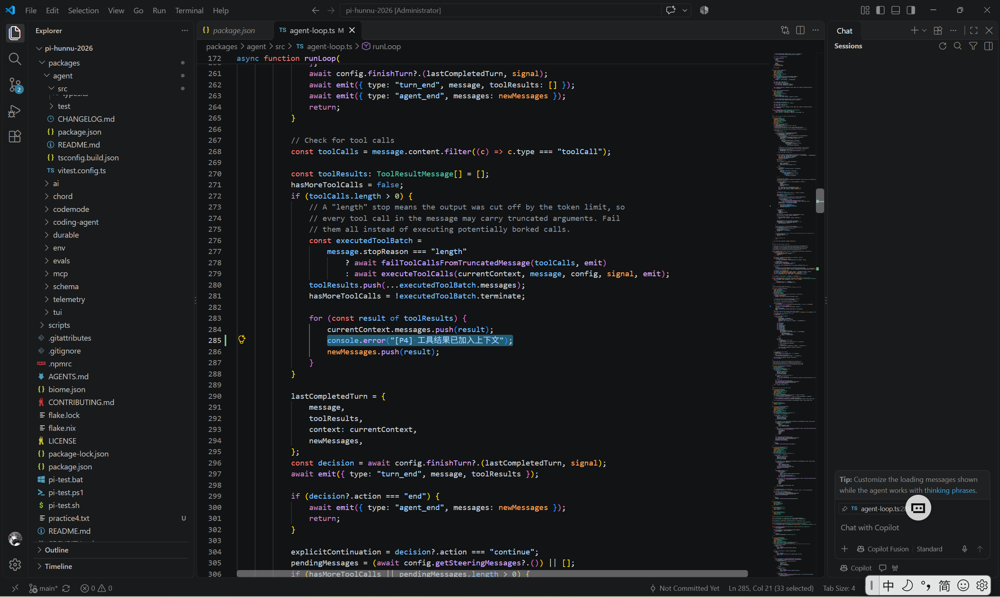
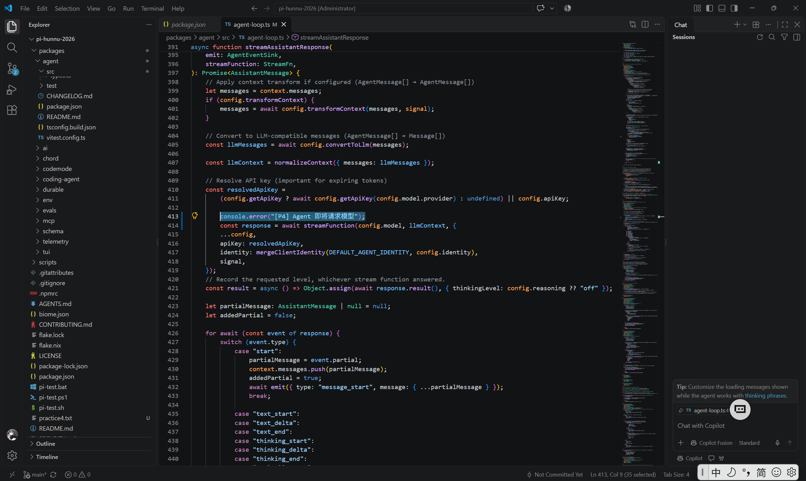
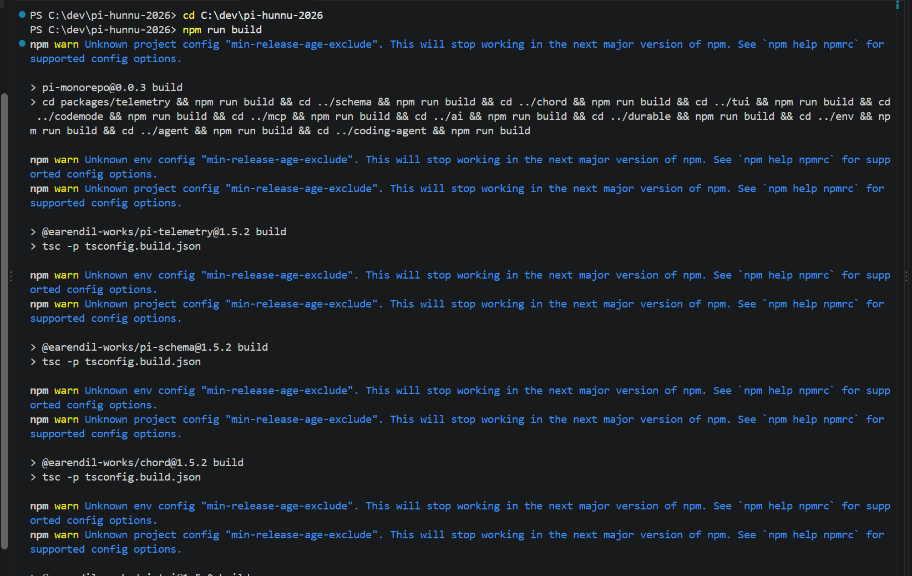
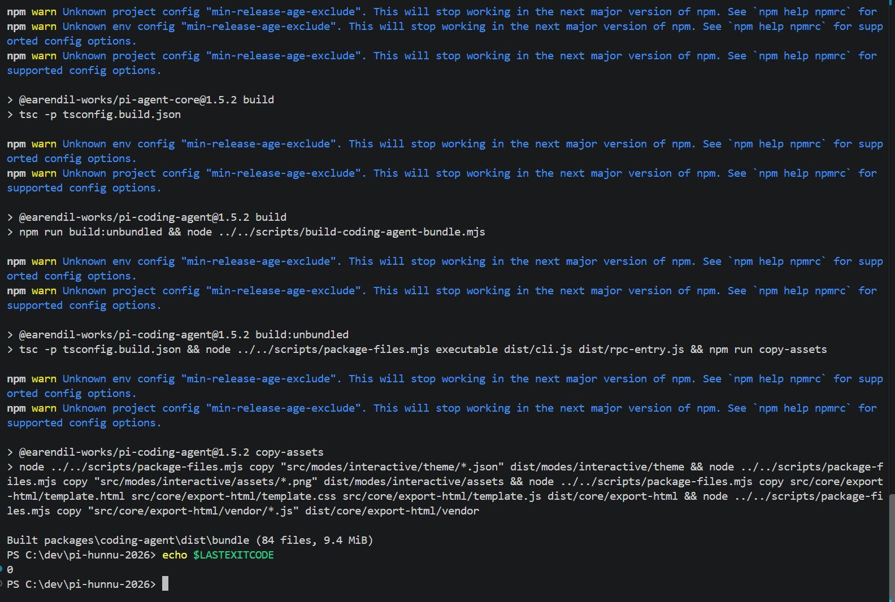
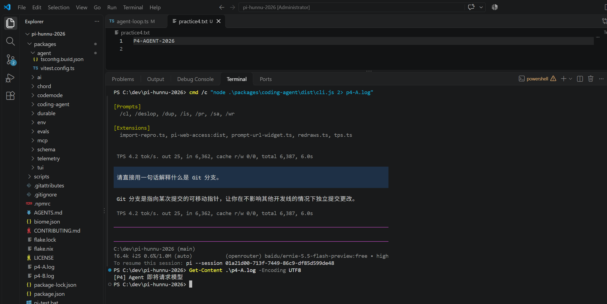
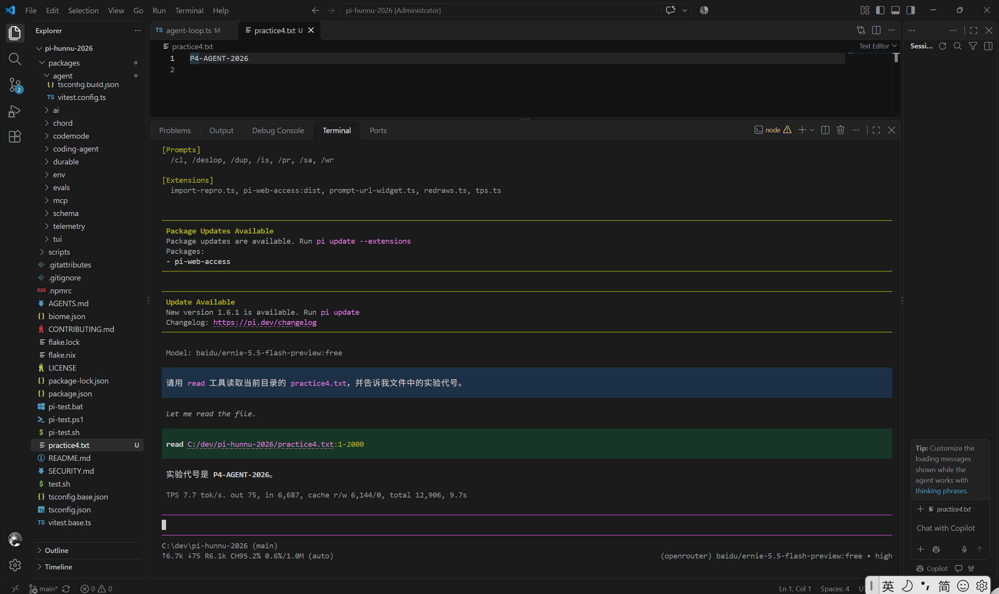
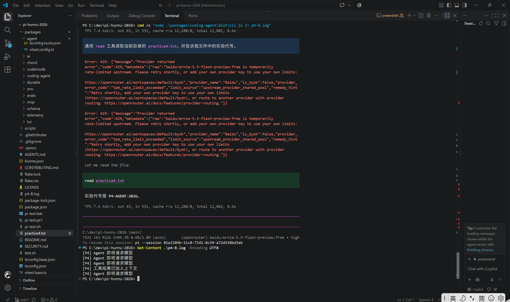
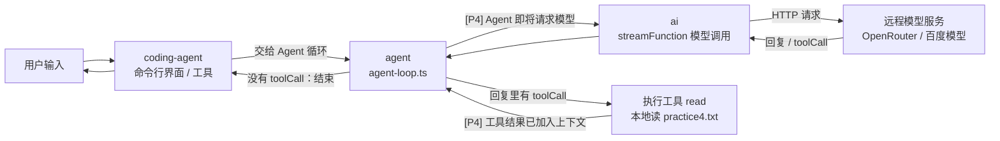

# 实践课4：Pi Agent模型调用与运行流程 yuaoran

- 姓名：于傲然
- 学号：202430224018
- GitHub：pupycyper
- 小组代码仓库：https://github.com/softh-dev/pi-hunnu-2026
- 本次使用模型：OpenRouter 免费模型 `baidu/ernie-5.5-flash-preview:free`

---

## 一、源码修改

**1. 模型调用前打印日志。** 搜 `const response = await streamFunction(`，在它上方（第 413 行）加了一行：

```ts
console.error("[P4] Agent 即将请求模型"); // 新增
const response = await streamFunction(config.model, llmContext, {
```



这行在 `streamAssistantResponse` 函数里，每次要把上下文交给模型调用函数之前都会走到这里。

**2. 工具结果加入上下文后打印日志。** 搜 `currentContext.messages.push(result);`，在它下方（第 285 行）加了一行：

```ts
for (const result of toolResults) {
    currentContext.messages.push(result);
    console.error("[P4] 工具结果已加入上下文"); // 新增
    newMessages.push(result);
}
```



这段在 `runLoop` 函数里：模型回复里如果有 `toolCall`，就会先执行工具，把得到的结果一条条放进上下文。

---

## 二、重新编译并启动

改完保存，在仓库根目录重新构建：

```powershell
cd C:\dev\pi-hunnu-2026
npm run build
echo $LASTEXITCODE
```





构建最后一行是 `Built packages\coding-agent\dist\bundle (84 files, 9.4 MiB)`，`$LASTEXITCODE` 是 `0`。日志里还能看到 `@earendil-works/pi-agent-core@1.5.2 build` 执行了 `tsc -p tsconfig.build.json`，我改的 `agent-loop.ts` 就是这一步被重新编译的。构建过程中依然有一堆 `min-release-age-exclude` 的 npm 配置警告，和实践课3一样，不是错误。

构建成功后，直接运行编译产物：

```powershell
node .\packages\coding-agent\dist\cli.js
```

必须用产物运行是因为日志是加在 `src` 里的，只有重新构建后，`dist` 里才有这两行。

一开始直接运行，`[P4]` 日志是写到终端的，会被 Pi 的界面刷新冲掉，只能偶尔看到一条，所以后面改成了把 stderr 存进文件：

```powershell
cmd /c "node .\packages\coding-agent\dist\cli.js 2> p4-A.log"
```

退出 Pi 之后再用下面的命令查看：

```powershell
Get-Content .\p4-A.log -Encoding UTF8
```



图里最上面一行就是启动命令，`node .\packages\coding-agent\dist\cli.js` 后面的 `2> p4-A.log` 只是把日志存进文件。Pi 成功打开，界面能正常提问和回复。

---

## 三、对比两次会话

先在项目根目录创建了 `practice4.txt`，里面一行实验代号：

```
P4-AGENT-2026
```

两次都是新开会话，用同一个模型 `baidu/ernie-5.5-flash-preview:free`。

### 会话 A：直接问答

- **输入：** 请直接用一句话解释什么是 Git 分支。
- **是否调用工具：** 没有
- **`[P4]` 日志（按顺序）：**

  ```
  [P4] Agent 即将请求模型
  ```

- **最终回复：** Git 分支是指向某次提交的可移动指针，让你在不影响其他开发线的情况下独立提交更改。
- **模型调用轮数：** 1 轮（用量：输入 6,362 tokens，输出 25 tokens，共 6,387）


### 会话 B：读取文件

- **输入：** 请用 read 工具读取当前目录的 practice4.txt，并告诉我文件中的实验代号。
- **是否调用工具：** 调用了 `read`，界面里能看到 `read C:/dev/pi-hunnu-2026/practice4.txt`
- **最终回复：** 实验代号是 `P4-AGENT-2026`

我一共跑了两次会话 B。

**第一次（日志干净）：** 当时我用 PowerShell 直接 `2> p4-B.log` 重定向，`type` 出来是乱码（PowerShell 5.1 重定向 stderr 时的编码问题，加上 `NativeCommandError` 的红字），但能数出来是 3 行，对应顺序是：

```
[P4] Agent 即将请求模型
[P4] 工具结果已加入上下文
[P4] Agent 即将请求模型
```

**第二次（用 cmd 方式重定向，日志不乱码）：**



```powershell
cmd /c "node .\packages\coding-agent\dist\cli.js 2> p4-B.log"
Get-Content .\p4-B.log -Encoding UTF8
```



这次文件里是 5 行：

```
[P4] Agent 即将请求模型
[P4] Agent 即将请求模型
[P4] Agent 即将请求模型
[P4] 工具结果已加入上下文
[P4] Agent 即将请求模型
```

比第一次多了两条"即将请求模型"。看终端里，`read` 之前连续出现了两次红色的 `Error: 429 ... baidu/ernie-5.5-flash-preview:free is temporarily rate-limited upstream`，是免费模型被上游临时限流了。我推测，前两次请求被 429 拒绝后又重试了，每次重试都会再走到加日志的那一行，直到第三次请求成功（这是我根据 429 次数和多出来的日志条数推出来的，没有去核对重试的源码）。

**模型调用轮数：** 不管有没有限流，成功得到回复的模型调用都是 **2 轮**：第一轮模型发出 `read` 调用，第二轮带着文件内容再请求，才得到最终回答。

### 谁实际读了文件？

是本地的 Pi 读的。模型本身看不到我电脑上的文件，它只是在第一轮回复里发出一个"我要调用 `read`，参数是 `practice4.txt`"的请求。`runLoop` 里发现回复里有 `toolCall`，就由 Pi 在本地执行 `read` 工具把文件读出来，得到的结果包装成工具结果消息，所以才会出现"工具结果已加入上下文"这条日志。

### 下一轮模型请求多带了什么？

多带了刚才那条工具结果，也就是 `practice4.txt` 的内容。第二次请求的上下文里除了原来的对话，还加上了这条工具结果。模型拿到文件内容之后，才能回答出代号 `P4-AGENT-2026`。如果没有这一步，模型是不可能知道我自己写的代号的。这也解释了为什么"工具结果已加入上下文"之后紧跟着一条"即将请求模型"。

### 运行流程简图



用户在 coding-agent 里输入，由 `agent` 里的循环决定下一步，要请求模型时通过 `ai` 去调用远程模型服务；模型如果要工具，`agent` 就在本地执行工具、把结果放回上下文，再请求一次模型，直到模型不再要工具为止。

---

## 四、遇到的问题与解决

**1. `[P4]` 日志被界面冲掉，数不准条数**

`console.error` 写到终端，和 Pi 的界面刷新混在一起，直接运行时有时只能看到一条。解决：把 stderr 存进文件（`2> p4-A.log`），退出后再看文件内容，条数和顺序就清楚了。

**2. PowerShell 重定向后日志是乱码**

一开始用 `node ... 2> p4-B.log`，`type p4-B.log` 出来是乱码，还带 `NativeCommandError` 的红字。原因是 Windows PowerShell 5.1 重定向原生命令的 stderr 时会按错误记录处理、编码也不对。解决：改用 `cmd /c "node ... 2> p4-B.log"` 让 cmd 做重定向，再用 `Get-Content -Encoding UTF8` 读取，就正常了。

**3. 免费模型 429 限流**

会话 B 第二次运行时出现 `Error: 429 ... temporarily rate-limited upstream`，导致日志里多了两条"即将请求模型"。这是模型服务那边的临时限流，不是代码问题。我没有重跑掩盖它，而是把有限流的和没有限流的两次都记下来，并解释了多出来的日志是怎么来的。

**4. 模型要选对**

之前的 `liquid/lfm-3-1.7b:free` 太小，担心不会正确调用 `read` 工具，所以这次换成 `baidu/ernie-5.5-flash-preview:free`，它能正常发出 `read` 调用。Pi 启动时默认的是 deepseek，需要在 `/model` 里手动切换，两次会话都用同一个模型。

---

## 五、小结

这次通过加两行日志，把 Agent 循环的运行过程看见了：直接问答只走一轮"请求模型"；需要工具时，是"请求模型 → 本地执行工具 → 工具结果进上下文 → 再请求模型"，每多一次工具调用就多一轮请求。我对"模型能读文件"也有了更准确的理解：读文件的其实是本地的 Pi，模型只负责决定要不要调用、以及根据返回的内容回答。另外这次也体会到，有的现象（比如日志条数）要用文件记录下来才能数准，限流这类外部因素也会影响日志，得结合报错来解释，不能照抄预期结果。
