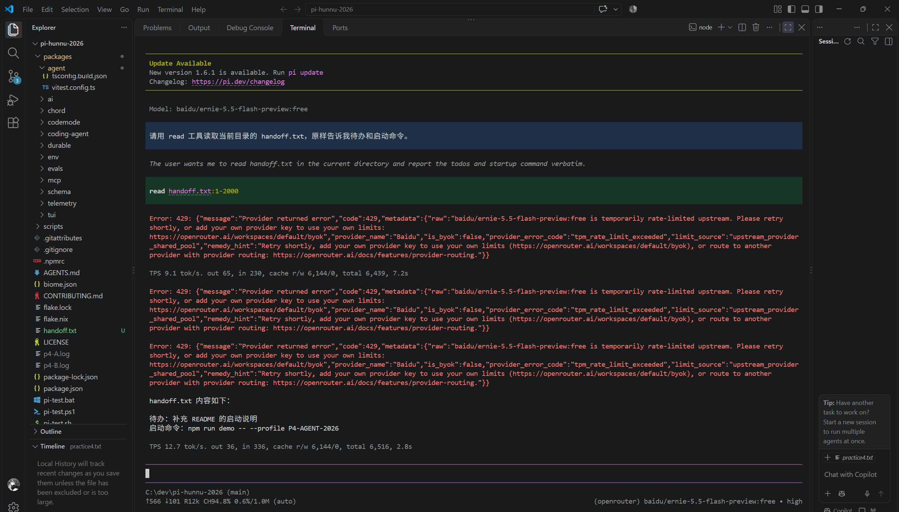
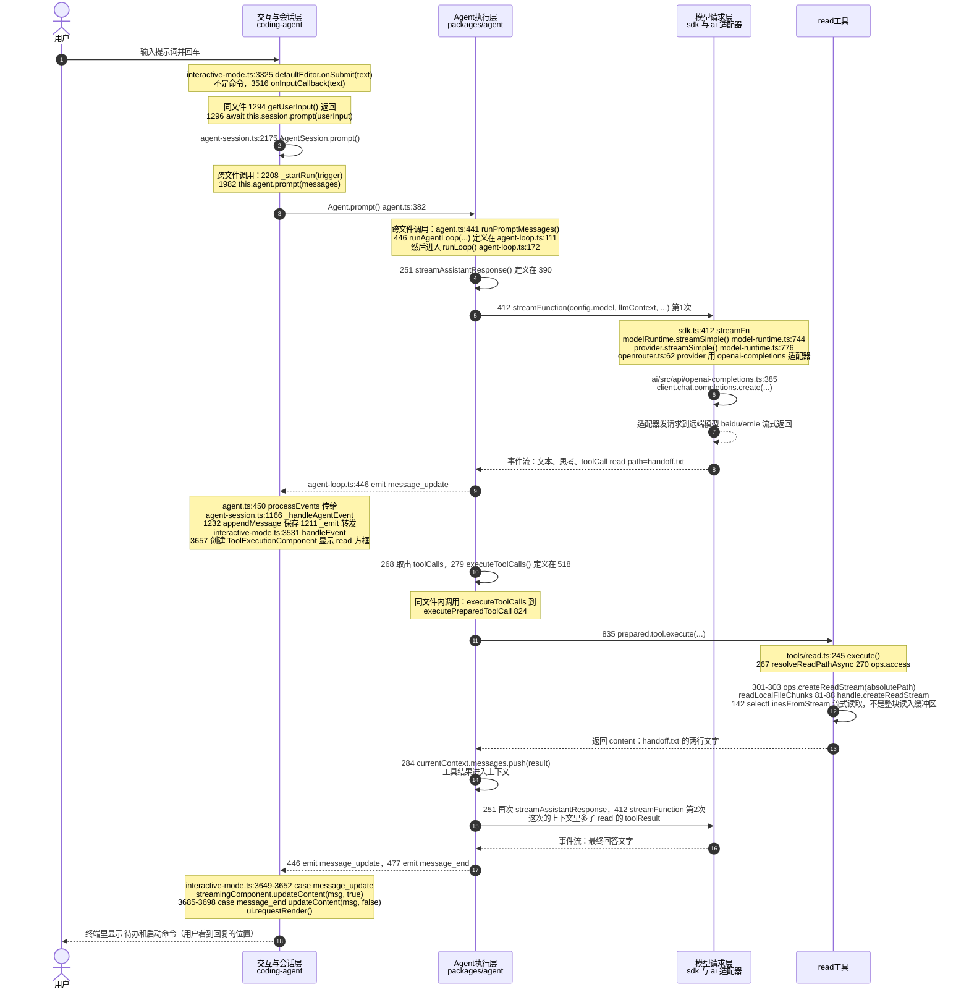
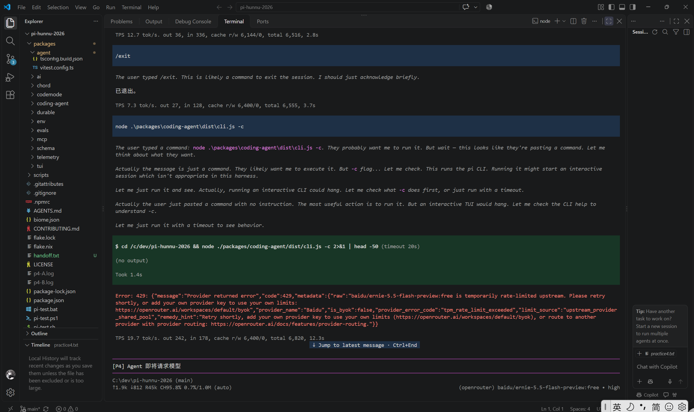
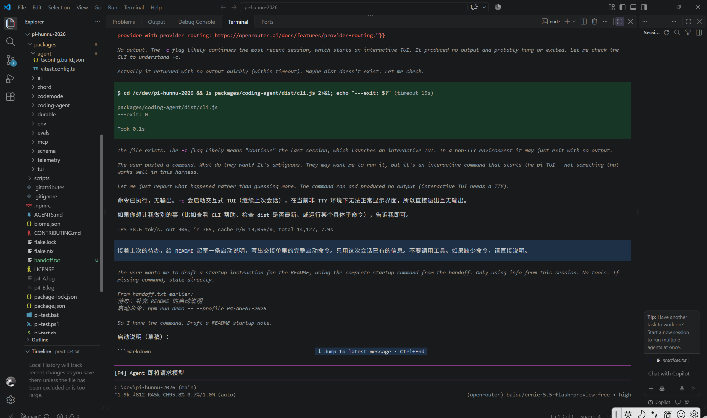
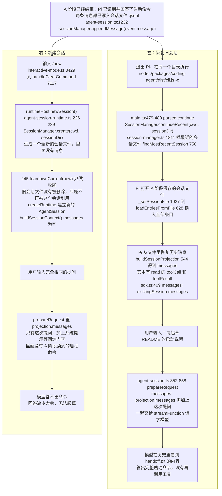

# 实践课5：Pi Agent工具调用与会话恢复 yuaoran

- 姓名：于傲然
- 学号：202430224018
- GitHub：pupycyper
- 小组代码仓库：https://github.com/softh-dev/pi-hunnu-2026
- 使用模型：OpenRouter 免费模型 `baidu/ernie-5.5-flash-preview:free`

---

## 一、A：单轮交互与工具调用

在项目根目录创建了 `handoff.txt`，两行内容（小组标识 `P4-AGENT-2026`）：

```
待办：补充 README 的启动说明
启动命令：npm run demo -- --profile P4-AGENT-2026
```

用实践4重新构建好的产物启动，新会话里输入：

```
请用 read 工具读取当前目录的 handoff.txt，原样告诉我待办和启动命令。
```



观察到的结果：

- 模型先发出一次 `read` 工具调用，界面上显示 `read handoff.txt:1-2000`，工具只执行了 1 次。
- 最后的回复是：待办：补充 README 的启动说明；启动命令：`npm run demo -- --profile P4-AGENT-2026`，和文件内容一致。
- 这次免费模型被限流了，终端里出现了 3 条报错，但最后还是成功拿到了回复。
- 界面里有两条用量统计（`in 230 / out 65` 和 `in 336 / out 36`），对应两次成功的模型调用，中间是一次 `read` 工具调用。

所以这一次输入，是**一轮交互里发生了 2 次成功的模型调用 + 1 次工具执行**。

---

## 二、图1：单轮工具调用的代码级时序图

下面是按"读取 `handoff.txt`"画的。五条生命线：用户、交互与会话层、Agent 执行层、模型请求层、`read` 工具。



### 图1说明

**输入入口。** `onSubmit` 只负责分发：`/model`、`/new` 这些斜杠命令在这里就被处理掉了；普通文字走到 `onInputCallback(text)`，把文本交给 `run()` 里的主循环，由 `await this.session.prompt(userInput)`（1296）真正进入会话。所以如果想在"用户一回车"的地方改功能，`onSubmit` 适合改命令，`AgentSession.prompt()` 适合改提示词预处理。

**启动循环。** `AgentSession.prompt()` 先处理扩展命令、模板、鉴权这些前置检查，通过 `_startRun()` 调用 `this.agent.prompt(messages)`（agent-session.ts:1982）。到 `packages/agent` 里，`Agent.prompt()` → `runPromptMessages()` → `runAgentLoop()` → `runLoop()`，这几步都是同一层里跨文件调用（`agent.ts` 到 `agent-loop.ts`）。

**模型与远端的边界。** `streamAssistantResponse()` 里的 `streamFunction(...)`（412）调用的是 `coding-agent` 在 `sdk.ts:412` 注入的 `streamFn`，它转给 `modelRuntime.streamSimple()`，再由 provider 选择适配器。我用的是 OpenRouter，它的 provider 声明了 `openai-completions` 适配器（openrouter.ts:62-82），一般情况下最后会在 `ai/src/api/openai-completions.ts:385` 用 `client.chat.completions.create(...)` 发出 HTTP 请求，远端模型的回复以事件流返回。（OpenRouter 的 provider 还声明了 `anthropic-messages`，我没有逐个核对本次所用模型具体是哪一种 api，按非 Anthropic 模型一般走 `openai-completions` 来画。）

**文件系统调用走的是流式读取，不是缓冲区读取。** 我核对了 `read.ts`：文本文件的读取（301-308）是

```ts
ops.createReadStream && isStreamableRange(offset, limit)
    ? await selectLinesFromStream(ops.createReadStream(absolutePath, { signal }), startLine, limit, signal)
    : selectLinesFromBuffer(await ops.readFile(absolutePath), startLine, limit);
```

默认的 `defaultReadOperations`（68-70）里提供了 `createReadStream: readLocalFileChunks`，它在 81-88 行用 `handle.createReadStream(...)` 一块一块读。这次模型调用 `read` 时没有传 `offset` 和 `limit`，`isStreamableRange(undefined, undefined)` 为真，所以走的是**流式**分支。只有当范围参数是小数、负数这类特殊值、或者操作对象没有 `createReadStream` 时，才退回到 `readFile` 读进缓冲区再切片的分支（`selectLinesFromBuffer`，130 行）。图片文件则是另一条路径，用 `ops.readFile` 整块读成 Buffer 再处理。

**显示回复。** 事件流会被转成 `message_update` 事件，一路经 `Agent.processEvents` → `AgentSession._handleAgentEvent`（同时 `appendMessage` 写进会话文件）→ `_emit` → `interactive-mode.ts` 的 `handleEvent`。`case "message_update"`（3649）里调用 `streamingComponent.updateContent(..., true)` 流式刷新，遇到 `toolCall` 就创建 `ToolExecutionComponent`（3657），也就是界面上那个绿色的 `read handoff.txt` 方框；`case "message_end"`（3685）收尾，调用 `updateContent(..., false)`，用户在这里看到最终回复。

**同一层内的跨文件调用。** 图里用 Note 标出的有两处：交互与会话层里 `interactive-mode.ts` 到 `agent-session.ts`；Agent 执行层里 `agent.ts` 到 `agent-loop.ts`。

---

## 三、B：恢复上次会话，继续写 README

### 3.1 恢复原会话（`-c`）

退出 Pi 之后，在同一个项目目录里重新用 `node .\packages\coding-agent\dist\cli.js -c` 打开，终端里能看到前面的聊天记录。然后输入：

```
接着上次的待办，给 README 起草一条启动说明，写出交接单里的完整启动命令。只用这次会话已有的信息。不要调用工具。如果缺少命令，请直接说明。
```



- **没有调用工具**：界面里没有出现任何 `read` 方框。
- **回答包含完整命令**：草稿里写出了 `npm run demo -- --profile P4-AGENT-2026`，并且说"命令来自本次会话读取的 handoff.txt"。

### 3.2 新建会话（`/new`）

用 `/new` 开新会话，界面显示 `✓ New session started`，同一个目录、同一个模型，输入完全相同的话：



- **没有调用工具**。
- **回答是"缺少命令，无法起草"**。

### 3.3 对照

|            | 恢复原会话（`-c`）                          | 新建会话（`/new`）           |
| ---------- | ------------------------------------ | ---------------------- |
| 提问         | 完全相同                                 | 完全相同                   |
| 模型         | `baidu/ernie-5.5-flash-preview:free` | 同左                     |
| 是否调用工具     | 否                                    | 否                      |
| 是否答出完整启动命令 | **是**                                | **否**，说缺少命令            |
| 输入的 token  | 7,403（无缓存）                           | 249 + 缓存 6,144 = 6,393 |

证据的结论是：**恢复后的回答里有 A 阶段才读到的命令，而且没有重新读文件**，这支持"它用了恢复出来的会话历史"；新会话里同样的问题答不出命令，反过来说明命令不在提问里，只存在于历史里。

说明：B 阶段我一开始误把 `/exit` 和 `-c` 命令输进了 Pi 的输入框，它们被当成消息发给了模型，我还在没退出的同一个会话里问过一次同样的 README 问题。所以被恢复的历史里除了 A 阶段读到的内容，还有这些多出来的消息，恢复后的回答不能完全只归因于 `handoff.txt` 的内容。

---

## 四、图2：恢复旧会话和新建会话的对照图



### 图2说明

两条分支都是从"A 阶段已经结束，Pi 已经读到并回答了启动命令"开始。

**左边，恢复旧会话。** `-c` 在 `main.ts:479-480` 被识别，调用 `SessionManager.continueRecent`（`session-manager.ts:1811`），找到最近的会话文件，`loadEntriesFromFile`（628）把里面的条目全部读进内存，再用 `buildSessionProjection`（544）还原成模型消息，`sdk.ts:409` 把这些消息作为 Agent 的初始 `messages`。之后每次请求模型之前，`agent-session.ts` 的 `prepareRequest`（852-858）又会从会话管理器重新生成一遍 `projection.messages` 作为请求的上下文。所以这次提问发给模型的，是**恢复出来的历史 + 新提问**，历史里有 A 阶段 `read` 的工具调用和工具结果消息，模型因此能直接答出命令。

**右边，新建会话。** `/new` 在 `interactive-mode.ts:3429` 分发到 `handleClearCommand`，调用 `runtimeHost.newSession()`。它用 `SessionManager.create` 建一个新的会话文件，`teardownCurrent` 只负责收尾旧会话（`abort`、发 `session_shutdown`、`dispose`），源码里没有删除旧文件的调用。新会话的 `projection.messages` 是空的，所以同一个提问只会带着这次的话去请求模型，历史里没有启动命令，模型只能说缺少信息。

**差别的原因。** 会话文件保存的是完整的消息序列，包括 assistant 的 `toolCall` 和 `toolResult`。恢复会话等于把这些消息重新放回请求的上下文里；新建会话则从空历史开始。

---

## 五、适合修改的位置

| 想改什么                  | 适合改哪里                                                                                                               |
| --------------------- | ------------------------------------------------------------------------------------------------------------------- |
| 用户输入的预处理，比如加快捷命令      | `interactive-mode.ts:3325` 的 `onSubmit`，或者 `agent-session.ts:2175` 的 `AgentSession.prompt()`                        |
| Agent 每一轮做什么、工具循环怎么控制 | `agent-loop.ts:172` 的 `runLoop()`                                                                                   |
| 模型请求的重试、超时、请求头        | `sdk.ts:412` 注入的 `streamFn`                                                                                         |
| 往哪个 provider 发请求      | `model-runtime.ts:744` 的 `streamSimple()`，以及 `ai/src/providers/` 下对应 provider                                       |
| 新增或修改工具               | `coding-agent/src/core/tools/` 下的文件，比如 `read.ts`                                                                    |
| 回复和工具方框怎么显示           | `interactive-mode.ts` 里 `handleEvent` 的 `message_update`、`message_end` 分支                                           |
| 会话怎么保存和恢复             | `session-manager.ts` 里的 `loadEntriesFromFile`、`buildSessionProjection`，以及 `agent-session-runtime.ts` 的 `newSession` |

---

## 六、遇到的问题

1. **429 限流。** A 阶段读取文件时终端里出现了 3 条 429 报错，但最后成功了。和实践4一样，是免费模型的上游限流，不是代码问题，这次我没有重跑，直接按观察到的情况记录。
2. **把命令输进了 Pi 的输入框。** 退出 Pi 要用 Ctrl+C，重新启动要回到终端里敲命令，Pi 的输入框里输入的所有内容都会被当成发给模型的消息。
3. **核对 `read` 是流式还是缓冲读取。** 我一开始以为只有一个 `readFile`，翻到 `read.ts` 才发现有 `createReadStream` 和 `selectLinesFromStream` 两条路径，要看传的参数才能决定走哪条，所以最后是按这次的实际调用（没有 `offset` 和 `limit`）判断走的是流式。

---

## 七、小结

这次从"看到的现象"回到了源码里，主要有三点：一次用户输入里可以有多次模型调用，工具执行结果回注上下文就是两次调用的分界；读文件的是本地的 `read` 工具，不是模型，而且按这个版本的源码，没有范围参数时走的是流式读取；会话恢复的本质是把保存的消息序列重新放进请求的上下文里，新建会话则是从空历史开始，所以同一个问题的答案会不一样。另外这次的操作失误也让我明白，做对照实验时，前面的操作会留在会话历史里影响后面的结果，要尽量保持每一步干净。
